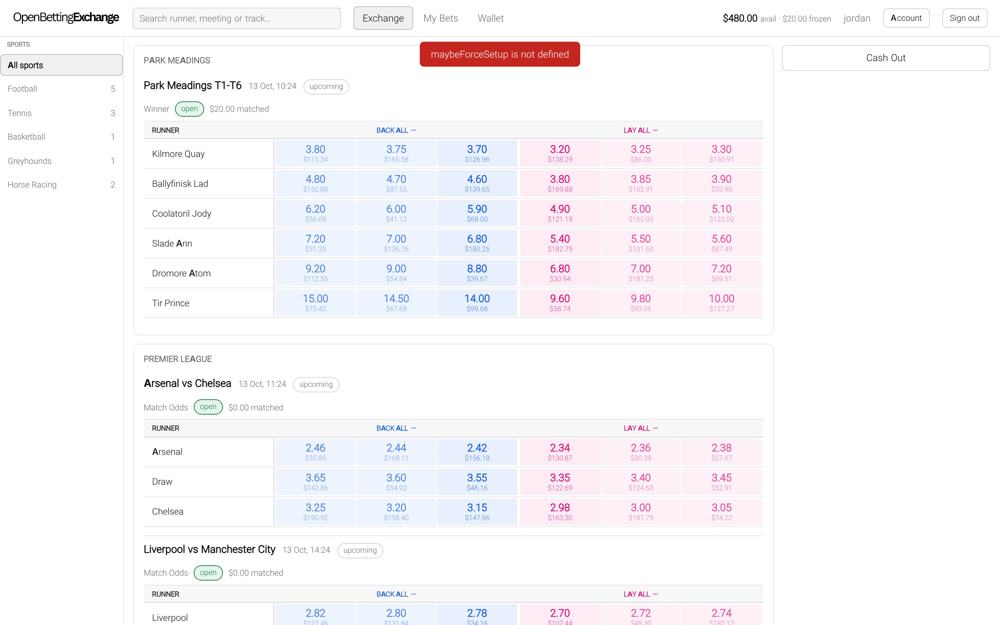
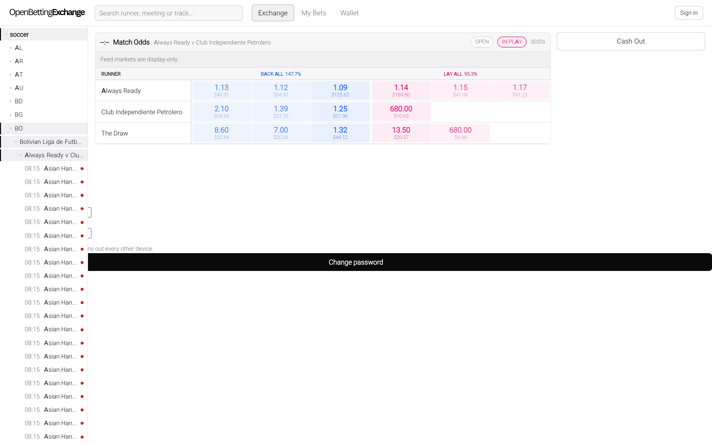
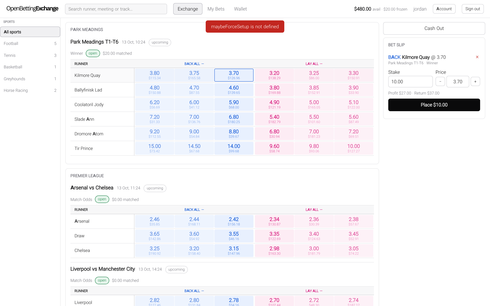
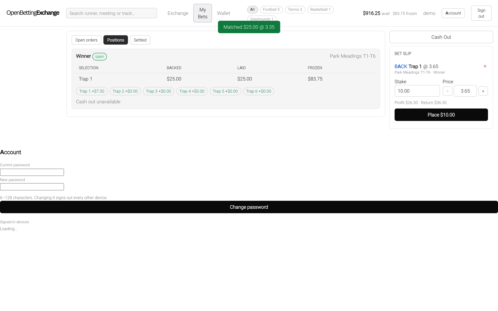
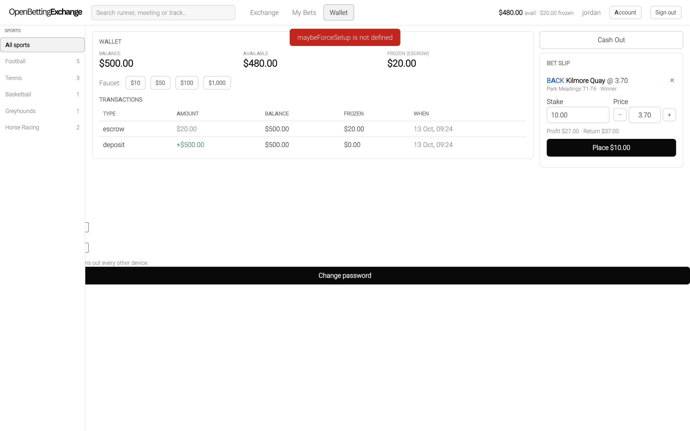
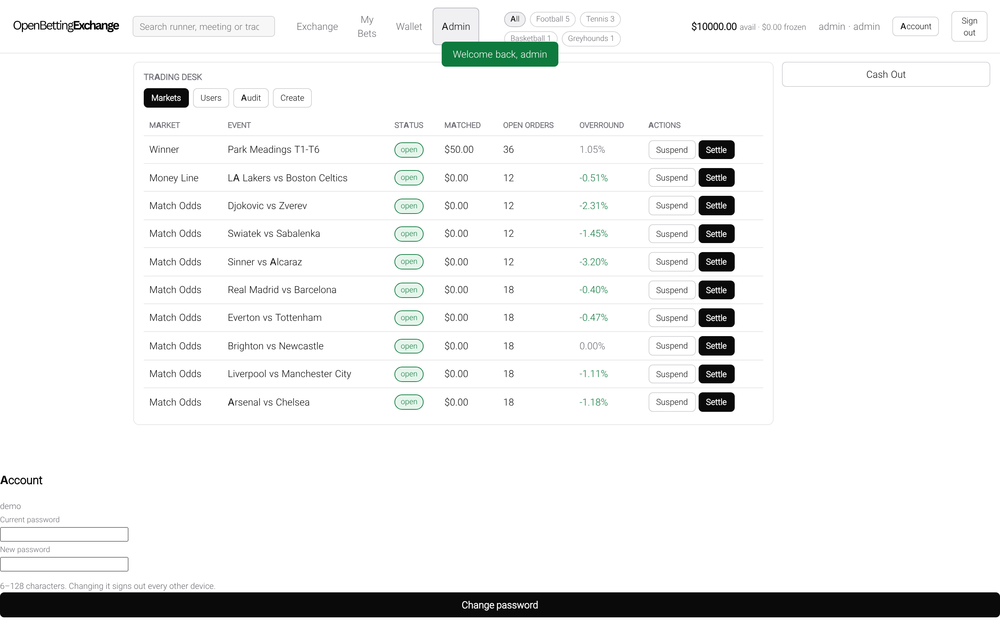
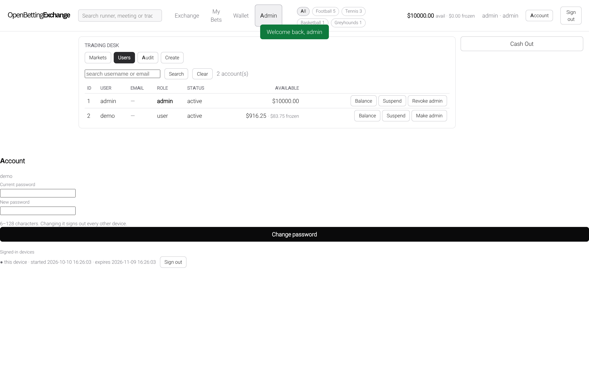
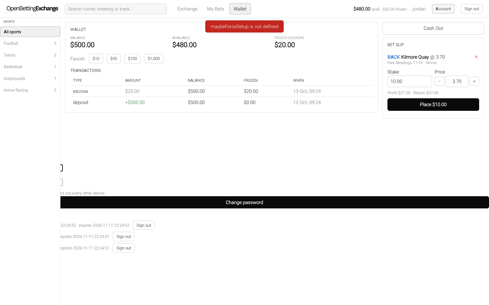

# OpenBettingExchange

[](https://github.com/wippa-studios/OpenBettingExchange/actions/workflows/ci.yml)
[](LICENSE)
[](package.json)
[](DISCLAIMER.md)

An open-source **peer-to-peer betting exchange**. Users back and lay against one
another through a real order book. A matching engine with price-time priority
fills the orders, a double-entry ledger accounts for every cent, and settlement
pays the pot. The operator's revenue is a commission on net winnings, not a
bookmaker's margin.

**Stack:** Node 22 · Express 5 · `node:sqlite` · zero-build frontend · **two**
runtime dependencies (`express`, `pg`) · MIT



> [!IMPORTANT]
> **Paper money only.** Every balance is play money and there is no real-money
> execution path. No payment service provider (PSP) is integrated, and no
> licensed operation stands behind this project. The payments machinery ships
> (deposit intents, confirmation-gated crediting, a withdrawal hold, webhook
> verification, reconciliation) but terminates in a reference provider that moves
> no money. See [`docs/EXCHANGE_RULES.md`](docs/EXCHANGE_RULES.md) for the full
> boundary.
>
> Operating a real-money exchange also requires a licence, and the obligations
> that come with it. Software cannot supply the licence. What software *can*
> supply is the mechanism and the enforcement — and this repository ships both for
> most of them, while shipping none of the vendor adapters. See
> [Compliance](#compliance).

> [!NOTE]
> **Evaluating this for a licensed Australian venue?** The useful summary is
> where the code stops, not what it does — so here it is, in the first screen.
>
> **Ships:** the matching engine, escrow, a double-entry ledger with fund
> segregation and conservation as queries rather than promises, settlement
> (withdrawn runners, dead heats, per-sport void rules, dispute holds), cash-out
> with venue-risk caps, responsible gambling and abuse controls, an operator
> desk, reporting, a results feed, a data-feed seam with two adapters, and the
> compliance **mechanisms** — identity pre-verification, AML/CTF monitoring, a
> deposit funding gate, a licensed data-source register — each with its
> enforcement wired in and its decision point named rather than guessed.
>
> **Does not ship:** a payment provider, a KYC provider, or a regulatory list.
> Those are seams with reference implementations, and the boundary is
> deliberate: which PSP and which screening vendor a licensed venue may use is
> not a question this repository should answer. See
> [`lib/payments/provider.js`](lib/payments/provider.js) and
> [`docs/COMPLIANCE.md`](docs/COMPLIANCE.md) §7.
>
> **Three facts worth having before you read another line.**
>
> - **It is pre-off only, and that agrees with Australian law.** Online in-run
>   betting is not permitted except by voice telephone or in licensed physical
>   venues, so the absence of in-play is not a gap you need to close — it is a
>   product decision that matches the jurisdiction. `lib/offtime.js` closes order
>   placement *and* cash-out at the event's off time, in the engine rather than
>   the routes, and treats an unparseable off time as CLOSED. Whether that
>   satisfies your licence conditions is your counsel's call.
> - **Race-field approvals follow the data, not the operator.** Racing NSW's
>   rules require an approval to use NSW race-field information *regardless of
>   where the operator is domiciled or licensed*, which is why
>   `lib/datasources.js` is a register — owner, approval, permitted uses, expiry
>   — and not a key. "Are we licensed enough to use this" does not reduce to a
>   tenant row. It ships empty, because a guessed licence reference is worse than
>   none.
> - **The currency is read, not assumed.** `VENUE_CURRENCY` defaults to `AUD`,
>   and accounts, reports and the frontend formatter all follow it rather than
>   hard-coding a `$`. The venue trades in exactly one currency — see
>   [`docs/EXCHANGE_RULES.md`](docs/EXCHANGE_RULES.md#currency).
>
> One caveat governs all of it: this codebase treats **a green test suite
> implying more than is true** as a defect class in its own right. Where a
> control is a convention rather than a gate, the documentation says so.

## Contents

- [Overview](#overview)
- [Quick start](#quick-start)
- [Feature status](#feature-status)
- [Screenshots](#screenshots)
- [Architecture](#architecture)
- [Financial invariants](#financial-invariants)
- [API](#api)
- [Configuration](#configuration)
- [Odds feed and the venue's own book](#odds-feed-and-the-venues-own-book)
- [Development](#development)
- [Known limitations](#known-limitations)
- [Compliance](#compliance)
- [Roadmap](#roadmap)
- [Security](#security)
- [Contributing](#contributing)
- [Licence](#licence)

## Overview

A bookmaker sets the odds and carries the risk. An exchange does neither: users
bet against each other, and the exchange earns only a commission. The whole
design follows from that distinction.

- **Back and lay.** A back bet is "this runner wins" (risk: the stake). A lay bet
  is "this runner loses" (risk: `(price − 1) × stake`). Both sides are offered on
  every runner, exactly like the exchange you know.
- **Limit orders on a real book.** Orders match with price-time priority, partial
  fills and a self-match guard. Fills execute at the *resting* order's price.
- **Escrowed risk.** Collateral is frozen while a position is open. Balances are
  reported as available versus frozen.
- **Commission on net winnings.** The house edge is applied at settlement, per
  user per market, and only on a positive result.
- **Transparent margin.** The admin desk reports each market's overround, derived
  from the live book, instead of hiding a spread.

Prices come from the built-in demo market-maker bots or, optionally, from a live
odds feed ([`docs/FEED.md`](docs/FEED.md)) — either the
[OpenBettingExchangeDataFeed](https://github.com/wippa-studios/OpenBettingExchangeDataFeed)
collector's Postgres views, or **your own JSON-over-HTTP feed API**, which
`FEED_PROVIDER=http` points at with no code change. An operator can materialise a
feed's catalogue into this venue's own book and quote it at its own prices; a
feed market that has not been materialised is still a reference row somewhere
else. See [Odds feed and the venue's own book](#odds-feed-and-the-venues-own-book).

The frontend is plain HTML, CSS and classic JavaScript with no build step and no
CDN. Fonts (self-hosted Inter), logo and favicon are all served from `public/`.
Light house palette — white ground, black text, grey accent.

## Quick start

**Requirements:** Node.js 22.13 or later (`.nvmrc` is provided).

```bash
npm install
npm run seed      # demo catalogue, users and bot liquidity
npm start         # http://127.0.0.1:7777
```

| Role | Username | Password |
| --- | --- | --- |
| Player | `demo` | `demo123` |
| Operator | `admin` | `admin123` |

Seeded credentials exist for local demonstration only. They require a password
change before the account can trade, and the server warns at boot while they are
in place.

### Walkthrough

1. **Board.** A sport rail on the left, competition-grouped event cards, and a
   ladder per market: three back prices, the runner and its last traded price,
   and three lay prices. Blue flashes mark price rises; red flashes mark falls.
2. **Trade.** Register an account (or sign in as `demo` and change the
   password), then click a price. The bet slip opens on that side and price.
   Adjust the stake or step the price along the ladder, then place the order. It
   matches against available liquidity or rests on the book.
3. **Positions.** *My Bets → Positions* shows per-runner backed and laid stakes,
   escrow held, and the if-this-wins P&L for every runner. Eligible positions can
   be cashed out.
4. **Wallet.** Available versus frozen balances, a play-money faucet, and a
   ledger of every escrow, release, payout and commission.
5. **Trading desk.** Sign in as `admin` to create the catalogue, read the
   fair-price helper (decimal, American, fractional, implied), monitor matched
   volume and overround, suspend a market, and settle it with a winning runner or
   void it. Settlement pays every matched pot, net of commission, immediately.
   A market can also be declared `payout_shape: 'place'` at creation, and a
   single runner can be removed before the off — which is what a withdrawn horse
   is.

## Feature status

| Capability | Status |
| --- | --- |
| Back/lay order book, aggregated depth, last traded price | Available |
| Matched volume at every price level, windowed; board mover view; price-history series | Available (`lib/marketdata.js`; the tape is kept 30 days — [`EXCHANGE_RULES.md`](docs/EXCHANGE_RULES.md#the-trade-tape-and-its-retention)) |
| Matching engine: best-for-taker sweeps, resting-price execution, partial fills, FIFO, self-match guard | Available |
| Escrow wallet: available vs frozen, full transaction ledger, faucet | Available |
| Settlement: pot distribution, void refunds, commission on net winnings, auto-cancel, double-settle protection | Available |
| Withdrawn runners: a declared non-runner voids that **selection** (orders cancelled, escrow released, backers refunded) while the rest of the market settles, and a **declared** deduction is then taken off the winnings of the runners that survived — the venue computes no scale, because the stewards declare one | Available (`lib/settle.js` `voidSelection`, [`EXCHANGE_RULES.md`](docs/EXCHANGE_RULES.md#the-declared-deduction-on-the-runners-that-survived)) |
| Dead-heat / joint-favourite settlement | Available |
| Cash-out: venue buyout priced from fair probabilities, any number of runners, all-or-nothing | Available |
| Cash-out venue-risk caps: unpaid exposure and daily outlay | Available (`lib/cashoutrisk.js`; operator-configured) |
| Pre-off only: bets and cash-out close at the event's off time (`lib/offtime.js`) | Available |
| Liquidity bots and fair-price drift | Available (disable with `BOT_ENABLED=false`) |
| Admin trading desk: catalogue, suspend/restore, settle, stats, overround | Available |
| Live updates | Available (SSE with a 15-second poll fallback) |
| Results feed: transport, per-sport void rules, held disputes, provenance, manual release | Available (transport requires `RESULTS_FEED_URL`) |
| Reporting: financial summary with self-check, player statements, volume, commission, operational | Available (`/api/admin/reports/*`, CSV or `?format=json`) |
| Session limit, reality check, deposit limit | Available, operator-configured (`0` = off; boot warns) |
| Tenant suspension: cancels resting orders, refuses betting, cash-out, deposits and login | Available (`PUT /api/admin/tenants/:id`; reads and the admin desk stay up — see [`docs/EXCHANGE_RULES.md`](docs/EXCHANGE_RULES.md#tenants-and-suspension)) |
| Responsible gambling: session, reality check, deposit cap, self-exclusion | Available (`lib/rg.js`) |
| Abuse controls: stake, market liability and daily settlement caps | Available (`lib/limits.js`) |
| Odds feed: a provider contract and registry, with two adapters — the collector's Postgres views, and a generic JSON-over-HTTP provider an operator points at **their own licensed feed API with no code change** (`FEED_PROVIDER=http`) | Available (`lib/feed/provider.js`, `lib/feed/postgres.js`, `lib/feed/http.js`; the HTTP provider is config-driven — base URL, resource paths, bearer token or static header, timeout, size scale and field maps that rename a vendor's JSON onto the canonical shape) |
| Provider conformance suite, run against both shipped adapters and a deliberately broken one as a negative control | Available (`tests/feedprovider-conformance.test.js`). **It is a review gate, not a runtime one**: `assertProvider` checks the six method names and that the name is declared, and never runs the battery — a boot must not be a test run. See [`docs/FEED.md`](docs/FEED.md#the-http-providers-keys) |
| Catalogue materialisation: `POST /api/admin/feed/sync` writes local `sports`/`events`/`markets`/`selections` with a stable `feed_map` in both directions, on an explicit, audited, rate-limited action | Available (`lib/feedcat.js`) |
| Venue-owned pricing on materialised markets | Available, and it is the point. **No feed price is ever written into `fair_price` or `ltp`** — a new selection is seeded even money (`FEED_BOOK_SEED_PRICE`) and a re-sync may rename a runner but never re-price one. A copied price is not a bad price, it is a good price a sharp client takes from you |
| A feed market that has **not** been materialised | Display only, and enforced by the engine: no local row, so naming its selection id is `404` before any collateral is taken. Pinned by `tests/feed-display-only.test.js` |
| Results id translation across the two id spaces | Available (`lib/feedcat.js` `admitSignal`). An id in neither space, or one that reads as two different runners, is **held by name** rather than guessed at |
| Fund segregation and conservation as a machine-asserted property | Available (`ACCT.segregation`, `ACCT.assertConserved`, published as `obx_ledger_drift_cents` in `/metrics`) |
| Customer pre-verification: provider contract, reference provider, and four enforcement points that refuse **before** collateral | Mechanism ships; **no vendor adapter** (`lib/identity/`, [`docs/COMPLIANCE.md`](docs/COMPLIANCE.md)) |
| AML/CTF monitoring: declarative rule set with its calibration reasoning, a rule engine, the AUD 5,000 threshold as a durable obligation, cross-account link analysis, and report generation | Available (`lib/aml/`). **Nothing is submitted to any regulator, and no alert blocks an account** |
| Third-party funding refusal at deposit intake: registered instruments, payment-method terms, funding-jurisdiction refusals | Available (`lib/funding.js`). The register **ships empty**; on an unregulated install the gate is inert |
| Licensed data-source register: owner, approval, permitted uses, expiry, with a pre-flight check | Available (`lib/datasources.js`). It ships empty and it refuses nothing until you register something: an outcome naming **no** source is recorded exactly as it always was, because inventing a licence attribution is the fabrication the register exists to prevent |
| In-play betting | Intentionally withdrawn; see [`docs/EXCHANGE_RULES.md`](docs/EXCHANGE_RULES.md#pre-off-only) |
| Accumulators, each-way | Not implemented |
| Real-money execution | Not implemented (no PSP integrated) |

## Screenshots

| | |
|---|---|
| **Board in feed mode.** Real fixtures and ladders from the feed. This is the reference book: a market shown here has no local row and is untradeable until an operator materialises it. | **Bet slip.** Clicking a price opens the slip on that side; stake and price step along the ladder. |
| [](docs/shots/feed-board.png) | [](docs/shots/betslip.png) |
| **Positions.** Per-runner backed and laid stakes, escrow held, and if-this-wins P&L. | **Wallet.** Available versus frozen, with a full ledger of deposits, escrow, releases, payouts and commission. |
| [](docs/shots/positions.png) | [](docs/shots/wallet.png) |
| **Admin trading desk.** Live catalogue with matched volume and overround; suspend, restore and settle. | **User administration.** Status, limits, balance adjustment and self-exclusion, each action audited with a reason. |
| [](docs/shots/admin-markets.png) | [](docs/shots/admin-users.png) |
| **Account and security.** Active sessions with device and IP, and the password-change path. | |
| [](docs/shots/account.png) | |

Screenshots are regenerated with `node scripts/shoot.mjs`. The script refuses to
save a capture it has not verified: each shot is preceded by DOM assertions that
the subject is actually on screen, and the run fails on any uncaught page error.

## Architecture

```text
browser   public/  plain HTML/CSS/classic JS, no build step
   │      REST + SSE (EventSource), httpOnly cookie session
   ▼
server    server.js  origin guard → sessions → routes → JSON 404 → static
   │
   ▼
engine    lib/       domain modules (below)
   │
   ▼
storage   data/openbettingexchange.db   SQLite (WAL), created on first run, gitignored
```

Dependencies flow one way: `match → ledger → tx`, with `settle` and `cashout`
layered on `match`.

| Module | Responsibility |
| --- | --- |
| `lib/tx` | Transaction depth; nested calls use savepoints |
| `lib/match` | Matching engine: sweeps, fills, escrow, book, positions |
| `lib/ledger` | Sole writer of balances and the transactions log |
| `lib/accounts` | Double-entry postings; conservation and segregation |
| `lib/settle` | Pot distribution, commission, void, cash-out close |
| `lib/cashout` | Venue buyout quote (any number of runners) |
| `lib/cashoutrisk` | Venue cash-out exposure caps: outlay and outstanding |
| `lib/voidrules` | Per-sport rule table: settle, void or hold |
| `lib/results`, `lib/resultsfeed` | Results ingestion, dispute holds, HTTP transport |
| `lib/limits` | Abuse controls: per-user caps, self-exclusion |
| `lib/rg` | Responsible gambling: session, reality check, deposit cap |
| `lib/risk` | Market-maker risk: caps, skew, kill switch |
| `lib/odds` | Tick ladder, American/fractional/implied formats, overround |
| `lib/offtime` | Pre-off cut-off enforcement |
| `lib/tenants` | Multi-tenancy, per-tenant commission, jurisdictions, tenant suspension |
| `lib/payments` | Provider interface and reference provider |
| `lib/identity` | Customer pre-verification: provider interface, reference provider, and the gate that stops an unverified account reaching money |
| `lib/aml` | AML/CTF: declarative rule table, engine, threshold obligations, report generation |
| `lib/funding` | Deposit intake gate: registered instruments, payment-method terms, third-party and jurisdiction refusals |
| `lib/datasources` | Data-source register: owner, approval, permitted uses, expiry |
| `lib/retention` | Which tables a generic retention job must not delete, and why |
| `lib/reports` | Regulatory, financial and operational exports |
| `lib/jobs` | Scheduled reconciliation and maintenance |
| `lib/ops` | Health, readiness, metrics, backup, restore |
| `lib/audit` | Append-only operator action log |
| `lib/auth` | scrypt password hashing, opaque session tokens |
| `lib/feed`, `lib/feedcreds`, `lib/feedrunner` | Odds feed reader, encrypted credentials, collector supervisor |
| `lib/feed/provider`, `lib/feed/postgres`, `lib/feed/http`, `lib/feed/shape`, `lib/feed/fieldmap` | The provider contract and registry, the two shipped adapters, and the single shaper both of them build on |
| `lib/feedcat` | Catalogue materialisation and the two-way identity map; the only place a feed id becomes a local id |
| `lib/bots`, `lib/drift` | Market-maker ladders and fair-price drift |
| `lib/userrules` | Player-authored betting rules, evaluated on the price stream |
| `lib/store`, `lib/seed` | Schema (38 tables) and fixtures |

The frontend (`public/js/`) is split into seven modules (`core`, `shell`, `nav`,
`board`, `slip`, `views`, `boot`) under the `window.OB` namespace. The eighth file,
`theme.js`, is deliberately outside it: it is a blocking script in `<head>` that
picks the palette before first paint, because a theme applied after the
stylesheet has painted is a white flash on every page load, and the venue's CSP
is `script-src 'self'` with no `unsafe-inline` for an inline snippet to hide in.

There is no ORM and no migration tool. The data model is a single readable SQL
file. Runtime dependencies are Express 5 and `pg` (the feed's Postgres client);
Playwright is a development dependency used by the browser suite. See
[`docs/ARCHITECTURE.md`](docs/ARCHITECTURE.md) for the design and its rationale.

> **Express 5.** The upgrade from 4 was not a dependency bump: Express 5
> compiles routes with path-to-regexp v8, which removed the optional-parameter
> syntax `:id?`, and three routes used it. Because those are top-level
> registrations, the router threw while `server.js` was being `require`d and the
> venue did not start at all. They are now registered twice — with and without
> `:id` — and `tests/express5.test.js` pins that, along with the pinned query
> parser, the `req.body`-is-`undefined` change, the error handler's
> post-response guard, and a version assertion so the migration cannot be
> silently reverted behind a green suite.

## Financial invariants

Read this table before changing the engine. Every row is asserted by a test. The
full specification, with worked examples, is in
[`docs/EXCHANGE_RULES.md`](docs/EXCHANGE_RULES.md).

| Invariant | Rationale | Tests |
| --- | --- | --- |
| Money is integer **cents**; one `Math.round` per liability, payout and fee | No drift; no two-round disagreements | `ledger`, `settle`, `store` |
| A back freezes its stake; a lay freezes `(price−1) × stake` at its own price | A layer's risk is reserved before matching | `match` (E1) |
| A lay fill of `f` at `P` keeps `round((P−1)·f)` frozen and adjusts the order's tracked remainder escrow so the wallet holds exactly that plus `round((Q−1)·remainder)`, releasing the difference or topping up the rare 1¢ | Settlement can never release more than is frozen; no cent is stranded | `match` (E3, E5, E14–E18) |
| A back taker sweeps resting lays `Q ≥ P` highest-first; a lay taker sweeps resting backs `P ≤ Q` lowest-first | The taker receives the best available price | `match` (E4, E5) |
| Fills execute at the **resting** order's price | The resting order's price is the market's price | `match` (E1) |
| FIFO within a price level (`id` tiebreak) | Price-time priority, not insertion luck | `match` (E13) |
| A user never matches their own order | No self-lay; own liquidity is not executable | `match` (E6) |
| Pot per match is `s + (Q−1)·s`; the winner is credited the pot | Settlement is zero-sum apart from commission | `settle` (S1–S3) |
| Void refunds each side its **own** contribution | Nobody wins or loses on a void | `settle` (S4, S10) |
| A **declared non-runner** voids that selection alone: its resting orders are cancelled, its matched legs refunded at the match price, and the market settles on the runners that ran | Settling a withdrawn runner charged a bettor a full stake on a horse that never started — and conservation stayed green, because the money went somewhere real | `nonrunner` (N1, N4), `voidrules` (V1) |
| A withdrawal notice before the off removes the runner while the market keeps trading; a sport with no withdrawal rule **holds** it instead | A racing concept applied to a football fixture would be an invented rule, and ignoring it would leave a player exposed | `nonrunner` (N4, N6), `voidrules` (V5) |
| A refund that cannot be audited **does not happen** | An unauditable transfer of a player's stake is the thing the audit trail exists to prevent | `nonrunner` (N3) |
| A **declared deduction** is taken off the winner's *winnings* on the runners that survived a scratching — and the **venue computes none**. The scale is published per jurisdiction and declared by the stewards, so the feed may carry one and the venue applies what it says | Refunding the scratch is *half* the Australian racing rule. The venue that stops there overpays the survivors' backers on every race with a late scratching — and conservation stays green, because the money goes somewhere real | `deductions` (D1, D2, D8) |
| A deduction is **refused and named** when it is malformed, negative, over 100%, ambiguous about its unit, or attached to a runner nobody withdrew | A bad figure that silently becomes "no deduction" is a full payout nobody authorised | `deductions` (D4, D9, D11) |
| A withdrawal with **no** declared deduction still settles, and the absence is **counted** | Refusing would strand a finished race; an unmeasured gap is worse than a tolerated one only if nobody is counting it | `deductions` (D3) |
| Commission applies to **net winnings per user per market**, only if positive | Mirrors the real-world model; never a fee on a loser | `settle` (S7) |
| A settled market is frozen and cannot settle twice | No double payment | `settle` (S6), `api` |
| Cash-out is a **venue buyout** priced at `Σ pᵢ·Payoutᵢ` less a margin, not a market hedge | Hedging N runners against a fair book destroys value; derivation in `lib/cashout.js` | `cashout2` (C1–C5) |
| Cash-out **holds** a position the venue cannot price fairly (underwater, unpriced runner) | Paying a player to exit risk they did not want hands out free money | `cashout2` (C3, C4) |
| A cashed-out match is flagged so settlement can never pay it again | Double settlement is the most severe failure this system could have | `cashout2` (C7), `cashout2` (C17) |
| Cash-out transfers the player's side to the venue | Excluding the match would strand the counterparty's collateral | `cashout2` (C8) |
| Cash-out is all-or-nothing, in one transaction | Never half-closed | `cashout` (C4) |
| The house bot may never cash out its own position | Self-dealing would manufacture a gain or a loss | `cashout` (C7), `cashout2` (C12) |
| Every money operation is one transaction (`lib/tx.js`) | A failure leaves no partial state | `tx` (X1–X6) |
| The database refuses invalid cents (`CHECK` constraints) | The invariant does not rely on JavaScript | `store` (D3) |
| Every posting set sums to **zero**; global conservation is a query | Double entry makes "where did this money come from" answerable | `ledger2` (D2, D7) |
| `users.balance_cents` is a **cache** of `player_funds` + `player_escrow`, proven per user | The two representations cannot drift silently | `ledger2` (D3) |
| Credit on **confirmation**, never on initiation | Ten abandoned deposit intents fund an account zero times | `payments` (P1, P4) |
| The daily deposit cap is scoped **per user**, not venue-wide | One player must not exhaust another's deposit allowance | `payments` (P9) |
| A repeated `client_order_id` returns the original order and takes **no second escrow** | A double submit is a financial incident | `idempotency` (I1, I6), `match` (I7) |
| Abuse limits are enforced **inside** the placement transaction | Check-then-act outside it would let concurrent placements both pass | `limits` (L13) |
| Self-exclusion **fails closed** on any stored end date it cannot parse | A player's request to stop must never be silently lifted | `rg` (G15, G17) |
| A disputed outcome is **held**, never settled or voided | Settling picks a side; voiding may give away money the venue owes | `results` (V3, R3) |
| `orders.frozen_cents` is written only by three named modules | The escrow invariant rests on it, and a convention is not a type | `guard` (G2) |
| An amend **keeps the order's `id`**, and `id` *is* the queue position | A cancel-and-replace at the same price silently demotes a trader behind everyone who arrived after them | `amend` (A6, and A7 as the control) |
| Escrow moves on an amend **only by the delta**, through the same helper the partial-fill path uses | Two copies of a sign convention on a money path is a cent released when it should have been frozen | `amend` (A1–A5), `guard` (G2) |
| The lapse sweep re-reads the order and the market **inside** the write transaction | A `matches` row against an order whose collateral was already released leaves a market unsettleable *and* un-voidable | `amend` (C5, two processes, one barrier) |
| The lapse sweep has **its own timer**, not the delay-release knob | A money-affecting promise that dies with an unrelated operational toggle | `orderlife` (R9) |

## API

JSON in, JSON out. Errors take the form `{ "error": "..." }`. Mutating requests
require a loopback `Origin` header (or none, for local tooling). Authenticate with
the `ob_session` httpOnly cookie, or with `Authorization: Bearer <token>` for
scripts. The complete reference, including every parameter, is in
[`docs/API.md`](docs/API.md).

| Endpoint | Purpose |
| --- | --- |
| `POST /api/auth/register`, `/login`, `/logout` | Account and session |
| `GET /api/me` | Current user, balance and escrow |
| `GET /api/sports`, `/api/events`, `/api/markets/:id/book` | Board and order book, with matched volume at every price level |
| `GET /api/selections/:id/price-history` | A runner's traded price over a window, bucketed (the trade tape's one reader) |
| `GET /api/movers` | Board ranked by what traded in the window — the same query as the ladder's matched column |
| `GET /api/feed/board`, `/api/feed/health` | Board from the odds feed (when `FEED_ENABLED=true`) |
| `POST /api/admin/feed/sync?limit=&offset=` | Materialise the feed's catalogue into this venue's own book (admin, audited). Answered with what it wrote, what it **refused and why**, and where a capped run resumes |
| `POST /api/orders`, `GET /api/orders`, `PATCH /api/orders/:id`, `POST /api/orders/:id/cancel`, `POST /api/orders/bulk-cancel` | Place, list, **amend in place** (keeps your queue position), cancel one or a list |
| `GET /api/positions` | Exposure, if-win P&L, cash-out quote |
| `POST /api/markets/:id/cashout` | Close a position |
| `GET /api/wallet`, `POST /api/wallet/deposit` | Balances and ledger |
| `GET /api/settlements` | Settled history |
| `GET /api/format/:price` | Decimal, American, fractional and implied price |
| `GET /api/stream` | SSE: `book`, `balance`, `orders`, `settlement` |
| `POST /api/admin/{sports,competitions,events,markets,selections}` | Build the catalogue (admin) |
| `GET /api/admin/competitions?sport_id=` | Competitions for a sport (admin) |
| `PATCH /api/admin/markets/:id` | Suspend or restore a market (admin) |
| `POST /api/admin/markets/:id/settle` | Settle with a winner or `void: true` (admin) |
| `POST /api/admin/markets/:id/selections/:selectionId/void` | Remove one runner before the off: `{ reason }`, ≥5 chars (admin) |
| `GET /api/admin/stats` | Matched volume, open orders, overround (admin) |
| `POST /api/admin/maintenance/price-history` | Apply the documented trade-tape retention policy, one bounded pass (admin) |
| `GET /api/identity/me`, `POST /api/identity/start`, `POST /api/identity/screen` | Customer pre-verification. **The screening endpoint returns no outcome** — tipping off is a criminal offence |
| `GET /api/admin/aml/rules`, `GET /api/admin/aml/alerts` | The suspicious-activity rule set with each rule's calibration reasoning, and the open alerts (entitlement-gated) |
| `GET /api/admin/aml/reports/{threshold-transactions,suspicious-matter}` | Generate the data a regulator needs. **Nothing is submitted to anyone** |
| `GET /api/admin/data-sources`, `GET /api/admin/data-sources/:id/check?use=settle` | Licensed data-source register and the pre-flight check: may I rely on this? |
| `GET /api/admin/retention` | Which tables a retention job must not delete — and the one it must not keep |

## Configuration

Configuration is read from `.env` (see [`.env.example`](.env.example)). Every
value is validated at boot; an invalid value **aborts startup** rather than
failing later.

> **Note:** `.env.example` documents **every key the code reads**, with the value
> `lib/config.js` actually defaults to, and `npm run check:env-example` fails the
> build the moment that stops being true — a key read but undocumented, a key
> documented that no code reads, or a default that drifts. The keys and their
> defaults are in the tables below.

### Core

| Variable | Default | Description |
| --- | --- | --- |
| `PORT` / `HOST` | `7777` / `127.0.0.1` | Listener. `HOST` is loopback-only by design |
| `DB_PATH` | `data/openbettingexchange.db` | SQLite file (`:memory:` for tests) |
| `VENUE_CURRENCY` | `AUD` | The one currency this venue trades in, validated at boot to an ISO-4217 code. Read by the ledger, payments, reports **and** `/api/branding`, which is what the frontend's formatter renders — there is no hard-coded `$` left |
| `COMMISSION_RATE` | `0.025` | Fee on net winnings |
| `FAUCET_MAX_CENTS` | `100000` | Faucet cap per deposit |
| `MIN_STAKE_CENTS` / `MAX_STAKE_CENTS` | `100` / `100000` | Order size bounds |
| `MARKET_VERSION_MATERIAL_THRESHOLD` | `2` | How many book-altering events a client may be behind before `POST /api/orders` refuses its order as stale. **Only affects clients that send a version** — omit it and the behaviour is exactly what it was before. `0` refuses on any movement |
| `SESSION_TTL_DAYS` | `30` | Session lifetime |
| `SCRYPT_N` | `65536` | Password hashing cost; floored at 16384 |
| `MAX_SSE_CLIENTS` | `2000` | Concurrent live streams; each holds a socket open |
| `MAX_SSE_CLIENTS_PER_SOURCE` / `MAX_SSE_CLIENTS_PER_USER` | `20` / `8` | Per-address and per-account bounds on the same pool, so one script or one account cannot take it. A fifth of the pool is reserved for signed-in players |
| `TRUST_PROXY_JURISDICTION` | `false` | Read the country header; enable only behind an edge that overwrites it |
| `DELAY_RELEASE_INTERVAL_MS` | `5000` | Interval for releasing expired delays into the book; `0` disables |

### Liquidity, cash-out and risk

| Variable | Default | Description |
| --- | --- | --- |
| `BOT_ENABLED` / `DRIFT_ENABLED` | `true` | Demo liquidity and price drift. The bots keep running with the feed on — the reference board has no local row for them to quote, and the venue's own book is quoted from its own prices. **Drift** is the venue's own price moving, and is still suppressed while the feed is on |
| `DRIFT_INTERVAL_MS` | `5000` | Drift cadence |
| `RISK_MAX_LIABILITY_CENTS` | `5000000` | Maximum debt the market-maker bot may carry |
| `RISK_MAX_DAILY_LOSS_CENTS` | `1000000` | Bot realised daily loss cap |
| `RISK_QUOTE_SKEW` | `0.5` | Ticks of widening at full loss pressure, `0`–`1`. **Zero gives a cliff, not a slope** |
| `RISK_MAX_SKEW_TICKS` | `20` | Ticks of widening at skew 1 and pressure 1 |
| `CASHOUT_ENABLED` / `CASHOUT_MARGIN_BPS` | `true` / `200` | Venue cash-out and its margin |
| `CASHOUT_MAX_OUTSTANDING_CENTS` | `2000000` | Total unpaid cash-out exposure ($20k) |
| `CASHOUT_MAX_DAILY_LOSS_CENTS` | `500000` | **Total cash-out outlay today** ($5k) — outlay, not realised loss |

### Odds feed

| Variable | Default | Description |
| --- | --- | --- |
| `FEED_ENABLED` | `false` | Read fixtures and prices from the feed |
| `FEED_PROVIDER` | `postgres` | Which implementation of the provider contract serves the board: `postgres` (the collector's views) or `http` (**your own JSON-over-HTTP feed API**). Anything else aborts startup |
| `FEED_DATABASE_URL` | none | Collector's Postgres URL; required when the feed is on and the provider is `postgres` |
| `FEED_NUMBER` | `2` | Feed to read: `1` fixtures only, `2` fixtures, prices and results |
| `FEED_STALE_SECONDS` | `300` | Frame age beyond which the board reports stale |
| `FEED_MARKET_LIMIT` | `60` | Markets returned to the board |
| `FEED_BOOK_SYNC_LIMIT` | `200` | Markets one `POST /api/admin/feed/sync` may materialise. Bounded on purpose: the catalogue is far larger than a page and each market costs a round trip |
| `FEED_BOOK_SYNC_CONCURRENCY` | `4` | Simultaneous `market()` calls during a sync — pressure on somebody else's licensed API, so it is capped |
| `FEED_BOOK_SEED_PRICE` | `2` | What a **newly** materialised selection is seeded with. Even money is a neutral starting position, not a view, and the **venue's** price |
| `FEED_HTTP_URL` and the `FEED_HTTP_*` family | see [`docs/FEED.md`](docs/FEED.md#the-http-providers-keys) | The HTTP adapter: base URL, resource paths, bearer token or one static header, timeout, in-flight and queue caps, size scale and field maps. **A misconfigured map aborts the launch**, because a map that renames nothing renders an empty board that looks like a quiet Tuesday |
| `FEED_CREDENTIALS_KEY` | none | 64 hex characters (AES-256-GCM key); generate with `openssl rand -hex 32`. **If unset, credentials are refused and never stored in plaintext** |
| `FEED_RUNNER_ENABLED` | `false` | Supervise the collector (spawn and restart) instead of running it separately |
| `FEED_COLLECTOR_CMD` | `betfeed collect` | Collector command, split on whitespace; an absolute path or wrapper works |
| `FEED_RUNNER_MIN_UPTIME_SECONDS` | `120` | Uptime a child must reach before a restart counts as a fresh start |

### Payments, operations and results

| Variable | Default | Description |
| --- | --- | --- |
| `OPS_TOKEN` | none | Required for `/metrics` and the backup control; unset means they return 404 |
| `PAYMENTS_WEBHOOK_SECRET` | none | HMAC secret for `POST /api/payments/webhook`; unset means the webhook returns 404 and no deposit can confirm |
| `DEPOSIT_MAX_CENTS` | `100000` | Per-intent cap on a confirmed deposit |
| `DEPOSIT_DAILY_MAX_CENTS` | `500000` | Per-user-per-day cap on confirmed deposits |
| `BACKUP_DIR` / `BACKUP_RETENTION` | none / `24` | Scheduled snapshots; unset means **backups are off**, and boot says so. The destination is config-only — it cannot be set per request |
| `RECONCILE_INTERVAL_MS` | `900000` | Scheduled reconciliation cadence |
| `RESULTS_FEED_URL` | unset | Endpoint polled for outcomes; unset means settle by hand or webhook |
| `RESULTS_FEED_SECRET` | unset | Sent as `Authorization: Bearer`; boot warns if the URL is set without it |
| `RESULTS_FEED_TIMEOUT_MS` | `10000` | Per-poll timeout, so a hung feed cannot stall the job |

### Responsible gambling

| Variable | Default | Description |
| --- | --- | --- |
| `RG_SESSION_MINUTES` | `0` | Session limit; `0` means not configured |
| `RG_SESSION_IDLE_RESET_MINUTES` | `15` | Idle gap that starts a fresh session; signing out does not |
| `RG_REALITY_CHECK_MINUTES` | `0` | Reality-check interval; `0` means not configured |
| `RG_DEPOSIT_DAILY_CENTS` | `0` | Rolling 24-hour deposit limit; `0` means not configured |

### Compliance

Every key here is a **posture** switch, not a feature toggle. The defaults are
off because they are off on a paper-money install, and the server says loudly at
boot which of them your deployment is not enforcing. Details in
[`docs/COMPLIANCE.md`](docs/COMPLIANCE.md).

| Variable | Default | Description |
| --- | --- | --- |
| `REGULATED_DEPLOYMENT` | `false` | "This venue holds a licence and serves real customers." The funding gate and the threshold obligation hang off it; with it off there are no payment instruments to inspect |
| `IDENTITY_REQUIRED` | `false` | Enforce customer pre-verification. **Turning it on with no real provider aborts the launch** — a mock that passes anybody must never sit behind a live onboarding flow |
| `IDENTITY_PROVIDER` | `''` | Which registered provider to select at boot |
| `IDENTITY_CALLBACK_SECRET` | unset | HMAC secret for the decision callback; unset means the callback route 404s |
| `AML_MONITORING_ENABLED` | `false` | Run the rule pass, on a timer and on demand |
| `AML_SCAN_INTERVAL_MS` | `3600000` | How often the scheduled pass runs; `0` disables the timer |
| `AML_THRESHOLD_CENTS` | `500000` | The AUD 5,000 customer-due-diligence exemption threshold |
| `AML_RESTRICTED_JURISDICTIONS` | `''` | Comma-separated ISO-3166 alpha-2. **Blank is a real state**, and the boot log says which state you are in |
| `FUNDING_REFUSE_UNREGISTERED` | `true` | Refuse a deposit whose funding instrument is not registered |
| `DATA_SOURCE_EXPIRY_WARN_DAYS` | `30` | When the licensed data-source register starts warning about an expiry |

## Odds feed and the venue's own book

`FEED_ENABLED=true` puts a live odds feed behind the board. There are two
adapters and they answer the same contract, so nothing above them knows which is
running:

| `FEED_PROVIDER` | What it reads |
| --- | --- |
| `postgres` (default) | The [OpenBettingExchangeDataFeed](https://github.com/wippa-studios/OpenBettingExchangeDataFeed) collector's Postgres views — unchanged behaviour |
| `http` | **Your own licensed feed API**, over JSON, with no code change. `FEED_HTTP_*` carries the base URL, the resource paths, a bearer token or one static header, the timeout, and field maps that rename a vendor's JSON onto the canonical shape |

The `http` adapter exists because the alternative was a fork. The price feed used
to be hard-wired to the collector's `v_feed1`/`v_feed2`, so an operator with their
own feed could use this venue only if their feed happened to be Betfair's Postgres
views — and a fork is not a seam, it is a copy that drifts.

**The seam came with a contract suite, because it had to.**
`tests/feedprovider-conformance.test.js` runs a battery against both shipped
adapters — the HTTP one against a real `node:http` server serving vendor-shaped
JSON — and includes a deliberately broken provider asserted to **fail** it, so the
suite cannot pass vacuously. `STATE.md` §2.7 is the design brief: *"an adapter
that half-works does not crash, it produces wrong prices or wrong market state,
which the engine cannot detect. Any adapter story needs a conformance suite
before it needs adapters."*

The honest caveat, because it is the one a reader would act on: `assertProvider`
**does not run the battery, and never will**. It checks the six method names and
that the provider's name is declared; registering a provider does not cause the
suite to run. Running an offline fixture suite at production startup would make
a boot a test run, and make the venue refuse to start because an assertion about
a synthetic fixture drifted. It is a **review gate** — CI plus the review that
accepts a declaration — and the code says so rather than claiming a control it
does not have.

Three properties from the security review are worth knowing before you point it
at a licensed API: a configured credential is never put in a log line or an
error (every word of every thrown message is one this codebase wrote), requests
are bounded by a concurrency semaphore with a bounded queue, and `/api/feed/*` is
rate-limited. Read `lib/feed/http.js` and [`docs/FEED.md`](docs/FEED.md).

### The venue quotes its own book

`POST /api/admin/feed/sync` materialises the feed's catalogue — local `sports`,
`competitions`, `events`, `markets` and `selections` — into this venue's rows,
recording every id it maps in `feed_map`. From then on those markets are the
venue's own, the bots quote them, and `POST /api/orders` accepts them. It is an
explicit, audited, rate-limited operator action: never automatic, not at boot, not
on a timer, not on a feed event.

**No feed price is ever written into `fair_price` or `ltp`.** A new selection is
seeded with the venue's own even money (`FEED_BOOK_SEED_PRICE`), and a re-sync may
rename a runner but never re-price one. `docs/FEED.md` names the hazard exactly:
the failure is not a bad price, it is *a good price that a sharp client takes
from you*. What a materialised market's price should actually be is a product
decision this repository has not made — the launch price model belongs to the
operator.

The bots are **not** suppressed in feed mode any more. They used to be, on the
premise that a bot would "requote over the observed Betfair book". That premise
never held: the observed market has no row here, so there is nothing for a bot to
quote over, while the suppression switched off the venue's only source of
liquidity — a board of real fixtures and not one bettable market in it. The
disjointness is now structural rather than a flag: the reference board has no
local row to name, and the venue's own book is quoted from the venue's own
`fair_price`. Drift, which is the venue's own price *moving*, is unchanged.

### The boundary that survives

A feed market that has **not** been materialised still has no local row, is
untradeable and unquotable, and `POST /api/orders` naming its selection id is
`404` — refused before any collateral is taken. The client refuses too, with the
message "Feed markets are display-only". That is enforced by the engine, not by
the client, and `tests/feed-display-only.test.js` pins all three legs, while
`tests/feedbook.test.js` pins the line from the other side: a materialised
neighbour of the same feed market *is* tradeable. The feed stays a reference
surface; materialisation is opt-in.

### Two id spaces, translated in both directions

A materialised market exists in the feed's id space *and* this venue's, and the
results protocol speaks integers in both. Before this, every outcome arrived
naming selections the market did not have: the withdrawal path held as
`non_runner_foreign`, the outcome path took the empty-winner hold branch, and
money sat in a held market with a withdrawn runner still quoted. `lib/feedcat.js`
translates in both directions and records which space a signal arrived in. An id
in neither space, or one that reads as two different runners of the same market,
is **held by name** rather than guessed at — local ids and a feed's runner ids are
both small integers, so the collision is ordinary rather than theoretical, and
settling it either way would be a coin flip with somebody's money on it.

### Betfair credentials

Betfair credentials are **not** set in `.env`. An operator enters them per tenant
in the admin dashboard. They are encrypted at rest and passed to the collector as
environment variables; the exchange never writes a `.env` file. See
[`docs/FEED.md`](docs/FEED.md).

| Endpoint | Access | Purpose |
| --- | --- | --- |
| `GET /api/admin/feed/credentials/:id?` | admin | Which fields are stored. **Never their values** |
| `PUT /api/admin/feed/credentials/:id?` | admin | Store app key, username and password; restarts a supervised collector |
| `DELETE /api/admin/feed/credentials/:id?` | admin | Remove credentials; stops a supervised collector |
| `GET /api/admin/feed/runner/:id?` | admin | Supervisor state, restarts, exit codes, scrubbed log tail |
| `POST /api/admin/feed/runner/start`, `/stop` | admin | Start or stop the collector |

Credentials are **scoped to the caller's own tenant**, enforced inside
`lib/feedcreds.js` against the actor rather than by the route: `:id` may only name
that tenant (`403` otherwise, `404` for one that does not exist), and there is no
venue-wide feed inventory. Each sealed field is additionally bound to its tenant
and field name as GCM associated data, so a row moved at the database level fails
to decrypt rather than becoming another venue's credential — and so does a single
column swapped between two rows, an envelope moved into another field, or one
truncated or emptied in storage. An integrity failure is never reported as an
absent credential.

`SIGTERM` and `SIGINT` drain the venue: job timers stopped, collector stopped
(SIGTERM, then SIGKILL after a grace period), listener closed, exit 0 — so a
restart cannot leave an orphaned collector still spending Betfair market-data
weight.

## Development

```bash


npm test            # 1282 checks: unit and API integration, fully offline

npm run test:smoke  # live end-to-end against a real server
npm run test:ui     # 220 checks: real Chromium via Playwright (board and admin desk)
npm run test:ui:shuffle   # the same 220 checks in a seeded random order (#134)
npm run docs:check  # fail if the documentation contradicts the code
```

The suite has no test framework: plain `assert`, numbered examples, no mocks.
Tests use in-memory or temporary databases, an ephemeral port and a disabled
drift loop, so `npm test` needs no credentials and no network. The browser suite
asserts the ladder's *geometry* as well as its presence; a mis-stacked price
column looks fine in a screenshot but fails an x/y assertion.

`npm run test:ui:shuffle` runs the same browser checks in a **seeded random
order** and prints the seed. It exists because the suite used to be one long
script: scenarios settled markets that later scenarios were written to find still
open, so the gate's result depended on *when* it ran — #134 measured three
clean-`main` runs as pass / fail / pass. Every scenario now builds its own
fixture and tears it down, and the shuffle is what keeps that honest. Replay a
failing order exactly with `npm run test:ui -- --shuffle=<seed>`.

**Before trusting a test, confirm it can fail.** Deliberately invert the
behaviour it covers and check it goes red. This repository has repeatedly shipped
bugs behind green tests — including a regression test that passed with the bug
reintroduced, because two ids coincided — so an assertion that cannot fail is
worse than no assertion, since it reads as coverage.

### Project layout

```text
lib/       engine and domain modules      server.js   HTTP and SSE wiring
public/    frontend (no build step)       tests/      unit/API suites, smoke, browser, guards
  js/      eight UI modules               docs/       architecture, rules, API, feed
scripts/   tooling (screenshots, load)    data/       SQLite database (gitignored)
```

## Known limitations

**No real-money execution.** The payments machinery ships, but no PSP is
integrated and the reference provider moves no money.

**The compliance mechanism ships; the vendor and the judgement do not.** Those are
different claims and only one of them is true here. What exists: an identity
provider contract with a reference implementation, customer pre-verification
enforced at four points before any collateral is taken, an age-assurance record
that is destroyed once used rather than retained on the user, an AML/CTF rule
engine calibrated against this venue's own ledger, the AUD 5,000 threshold as a
durable obligation, cross-account link analysis across tenants, a
registered-instrument gate that refuses third-party funding, tipping-off controls
on the reporting surfaces, and the licensed data-source register. What does
**not** exist is any vendor adapter. `lib/payments/provider.js` states that
boundary, and it was restated deliberately rather than quietly: which PSP and
which screening vendor a licensed venue may use is a question with legal review
behind it, and shipping an answer would be shipping this repository's guess at
somebody else's compliance position.

**In-play is a deliberate omission, not a gap** — and it agrees with Australian
law, which does not permit online in-run betting except by voice telephone or in
licensed physical venues. The venue closes bets and cash-out at the event's off
time (`lib/offtime.js`). Separately from the law, an in-play price is a forecast
of a future event while the book reacts to what everyone can see, so a venue that
publishes instantly is systematically slower than its own liquidity. Established
venues delay in-play prices for this reason, and removing in-play removes that
class of sharp. See
[`docs/EXCHANGE_RULES.md`](docs/EXCHANGE_RULES.md#pre-off-only).

**Not implemented:** accumulators and each-way betting. Dead-heat joint-favourite
settlement *is* implemented: the payout divides among joint winners where the
sport's rules permit, and a multi-winner signal under a single-winner rule is
held for review.

**Cash-out venue risk is capped, not open.** `lib/cashoutrisk.js` refuses a quote
when unpaid exposure reaches `CASHOUT_MAX_OUTSTANDING_CENTS` or the day's cash-out
outlay reaches `CASHOUT_MAX_DAILY_LOSS_CENTS`. The daily cap gates on **outlay**
rather than realised loss deliberately: realised loss is backward-looking, so by
the time it is measurable the money is gone, whereas outlay is known at decision
time and genuinely bounds the worst case.

**Single-node operation.** SQLite is single-writer and synchronous, which is why
the match sweep is atomic, but it limits the system to one process on one
machine. Measured on a developer laptop (`npm run load`): roughly 500 orders per
second placed (p99 about 206 ms at 50 concurrent) and 1,000–2,000 reads per
second, with the ledger still balanced to zero afterwards. Placement is about
four times slower than reads because it performs escrow, the match sweep and
double-entry postings. Treat these figures as a single-node floor, not a capacity
claim.

**Demo-grade pricing and credentials.** The demo bot's fair prices follow a
random walk, not a model. Seeded credentials are committed deliberately for the
demo; boot warns and a first-run password change is required. **Do not deploy
this as-is.**

The full list and rationale are in
[`docs/EXCHANGE_RULES.md`](docs/EXCHANGE_RULES.md#what-is-deliberately-not-implemented).

## Compliance

An Australian deployment has obligations this repository implements the
**mechanism** for and deliberately does not decide for you: customer
pre-verification before an account is created, AML/CTF monitoring against the
published online-betting indicators, the AUD 5,000 threshold, the racing-data
approvals that apply regardless of where you are licensed, and the question of
whose money a deposit is.

The distinction that is easy to get wrong, so it is worth stating flatly:
**the enforcement is here and the vendor is not.** Identity refuses at four
points in the engine and the money path; the AML pass runs on a timer and on
demand; a deposit whose funding instrument is unregistered is refused at intake
on a rail where accepting it wrongly is irreversible; an outcome naming a data
source whose licence does not permit settling is refused. What is missing is an
adapter for any of them, because the adapter is the part that needs somebody's
licence and their counsel.

Every one of them follows the two precedents already in the codebase — the
`lib/payments/provider.js` boundary (**no vendor is built in, and that is the
deliverable**) and the `lib/jobs.js` findings pattern (**a discrepancy has to
survive being ignored**). Start at
[`docs/COMPLIANCE.md`](docs/COMPLIANCE.md), and read its §7 — *what this
repository does not do* — before anything else, because it is a list of decisions
that are yours.

The one thing worth doing before you deploy: the server says **loudly at boot**
which of these are not enforced on your deployment.

## Roadmap

- Integrate a real PSP against the `lib/payments` interface
- Integrate a real KYC/screening provider against the `lib/identity` interface —
  the seam and the contract ship; the adapter does not
- Accumulators and each-way markets
- Decide the launch price model for a materialised market (`FEED_BOOK_SEED_PRICE`
  seeds even money so the market is tradeable at all; what it should actually be
  is the operator's)

Completed items are recorded in the [changelog](CHANGELOG.md).

## Security

Do not report vulnerabilities in public issues. Follow the process in
[`.github/SECURITY.md`](.github/SECURITY.md).

## Contributing

Contributions are welcome. The one non-negotiable rule is that the money must
balance. Please read [`CONTRIBUTING.md`](CONTRIBUTING.md) and the
[Code of Conduct](CODE_OF_CONDUCT.md) before opening a pull request.

## Licence

Released under the MIT Licence. See [`LICENSE`](LICENSE). Copyright © wippa-studios.
